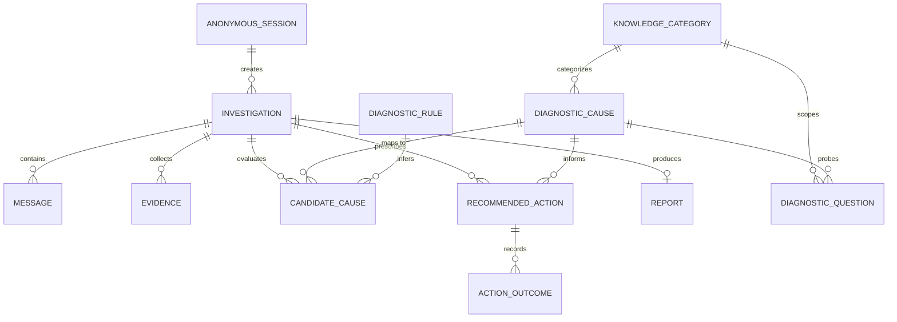

# CLUEZY System Architecture

## Overview

CLUEZY is an AI-powered technical troubleshooting platform designed to diagnose, isolate, and remediate technical issues step-by-step. Rather than guessing answers, CLUEZY gathers evidence, formulates candidate causes, recommends targeted verification tests, and guides users through structured remediation.

---

## High-Level Architecture

The repository adheres to a clean separation of concerns:

```
CLUEZY/
├── frontend/           # Static pre-rendered React application
├── backend/            # Modular monolithic FastAPI backend
│   ├── app/
│   │   ├── core/       # Configuration, Database engine, Security & Error handlers
│   │   ├── models/     # 12 SQLAlchemy 2.0 ORM domain models
│   │   ├── schemas/    # Pydantic v2 validation and serialization schemas
│   │   ├── services/   # Business logic (Sessions, Investigations)
│   │   ├── api/        # REST endpoints and dependency injection
│   │   └── ai/         # Groq SDK client wrapper (openai/gpt-oss-120b)
│   ├── alembic/        # Database schema migrations
│   └── tests/          # Pytest automated test suite
├── docs/               # System documentation & API contracts
├── .gitignore
└── README.md
```

---

## Approved Technology Stack

| Layer | Component | Details |
| :--- | :--- | :--- |
| **Frontend** | React / Next.js static build | Served locally via `serve.js` on port `5173` |
| **Backend** | FastAPI + Python 3.12+ | Async REST API, Pydantic v2, Uvicorn |
| **ORM & Migrations** | SQLAlchemy 2.x + Alembic | Declarative mapping, AsyncSession (`asyncpg`), sync migrations |
| **Database** | Supabase PostgreSQL | Managed PostgreSQL 15+ with SSL & connection pooling |
| **Authentication** | Supabase Auth (Google OAuth) | Dual auth: Google OAuth (ES256 JWKS) + Anonymous sessions (`clz_...`) |
| **AI Inference** | Groq Python SDK | Primary Model: `openai/gpt-oss-120b` |
| **Deployment** | Vercel | Serverless Python backend (`backend/vercel.json`) |

---

## Entity-Relationship Architecture

The foundational milestone establishes 12 database entities supporting the diagnostic workflow:



### Entity Descriptions

1. **`AnonymousSession`**: Manages non-authenticated user sessions, cryptographic session tokens (`clz_...`), expiration (30 days), and daily token budgets (200,000 tokens/day).
2. **`Investigation`**: Core troubleshooting session with unique reference ID (e.g. `INV-2387`), optional Supabase authenticated user ownership (`user_id`), anonymous session association (`session_id`), device type, problem description, category, and lifecycle status (`active`, `testing_solution`, `resolved`). Supports seamless claiming from anonymous sessions to authenticated Google accounts.
3. **`Message`**: Sequential dialogue turns between the user and assistant, including quick-response chips.
4. **`Evidence`**: Known verified facts and observations ("What we know"), e.g., device type, network state, symptom confirmation.
5. **`CandidateCause`**: Potential root causes under evaluation with likelihood ranking (`High`, `Medium`, `Low`) and status (`suspected`, `testing`, `confirmed`, `ruled_out`).
6. **`KnowledgeCategory`**: Technical domains (Network, OS, Software, Programming).
7. **`DiagnosticCause`**: Knowledge base catalog of known root causes.
8. **`DiagnosticQuestion`**: Targeted troubleshooting questions to isolate specific failure modes.
9. **`DiagnosticRule`**: Deterministic rules correlating observed symptoms to cause probabilities.
10. **`RecommendedAction`**: Step-by-step verification checks or remediation procedures.
11. **`ActionOutcome`**: Feedback reported by user on recommended action outcomes (`working`, `not_working`, `need_help`).
12. **`Report`**: Final autopsy and resolution documentation generated upon problem resolution.

---

## Supabase PostgreSQL Connectivity

- **Runtime Driver**: `asyncpg` via `postgresql+asyncpg://...`
- **Migration Driver**: `psycopg2` via `postgresql://...`
- **PgBouncer Compatibility**: Supabase uses connection poolers; SQLAlchemy engine is pre-configured with `statement_cache_size=0` to ensure flawless operation in transaction pooling mode.
- **Resilience**: `pool_pre_ping=True` detects dropped pooled connections automatically.
- **Local Fallback**: Zero-configuration local development falls back to SQLite (`sqlite+aiosqlite:///./cluezy.db`) if Supabase connection strings are not provided.

---

## AI Inference Architecture (Groq)

- **Primary Model**: `openai/gpt-oss-120b`
- **SDK**: Official `groq` Python client (`AsyncGroq`)
- **Key Isolation**: `GROQ_API_KEY` is loaded strictly on the backend and is never exposed to client-side code or headers.
- **Fallback**: When running in offline or test mode without API keys, structured fallback mechanisms maintain operational integrity.

---

## Frontend Integration Bridge

The frontend communicates with the backend via REST over HTTP:
1. On initial visit, frontend calls `POST /api/v1/sessions` to obtain an `X-Session-Token` and stores it in `localStorage`.
2. Subsequent requests to `/api/v1/investigations` attach the `X-Session-Token` header.
3. Chat interactions, evidence panels, and recommended actions synchronize with backend responses.

---

## Deterministic Diagnostic Engine (Milestone 3)

The diagnostic decision-making process is entirely decoupled from the LLM, ensuring predictable, explainable, and deterministic troubleshooting:

1. **Diagnostic Rule Engine (`app.diagnostic.rules`)**:
   - Evaluates collected evidence against rule sets.
   - Evaluates positive evidence (+delta with reason), negative evidence (-delta with reason), and neutral/unknown evidence (0.0 delta, no penalty).
2. **Cause Scoring Engine (`app.diagnostic.scorer`)**:
   - Adjusts scores and maps to categorical likelihoods (`High`, `Medium`, `Low`, `ruled_out`).
   - Plausible causes are never discarded merely because one fix failed.
   - Every adjustment maintains a clear identifiable reason chain.
3. **Diagnostic Question Planner (`app.diagnostic.planner`)**:
   - Calculates question discriminative power between leading candidate causes.
   - Strictly prevents repeating answered questions or asking about known evidence.
   - Recommends solutions once confidence threshold is satisfied.
   - Requires explicit user confirmation to mark an investigation resolved.


